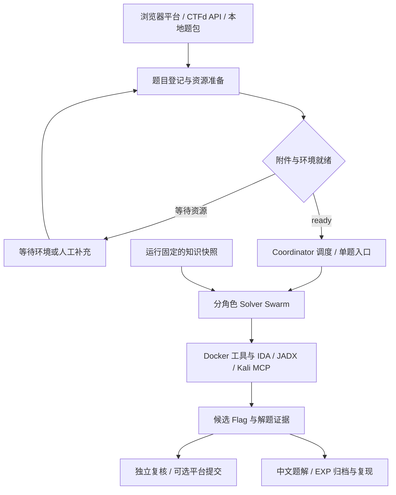

# CTF Agent All

**本项目由 w1eat 参考 [verialabs/ctf-agent](https://github.com/verialabs/ctf-agent) 项目开发。** 在多模型协作解题的思路上，围绕比赛平台接入、题包准备、独立验证、MCP 分析工具、知识检索和中文题解管理进行了扩展。

CTF Agent All 面向 CTF 比赛与本地题目研究：Coordinator 负责发现题目和分配任务，Solver Swarm 通过多个模型、不同分析角色和 Docker 工具环境完成解题，随后记录候选 Flag、验证证据、中文题解和 EXP。

[完整中文使用指南](README.zh-CN.md) · [配置模板](.env.example) · [Solver MCP 配置](solver-mcp.example.json) · [知识检索评估](docs/knowledge-evaluation.md)

## 本项目的创新与扩展

| 设计重点 | 当前实现及用途 |
| --- | --- |
| 浏览器平台接入 | 使用 Playwright MCP 登录、观察页面、发现题目、下载附件、启动环境及操作提交表单，支持非标准 CTFd 前端。 |
| 题包状态与准备队列 | 将资源准备和解题并发分开控制；附件校验与环境登记完成后才派发 Solver，状态写入 SQLite 并支持按运行 ID 恢复。 |
| 分角色协作与独立复核 | Solver 可承担侦察、静态分析、动态利用、替代路线或验证角色；候选 Flag 经过独立来源复核，单模型也可启动新的验证会话。 |
| 统一 MCP 分析入口 | Claude、Codex 和 API Solver 共用 IDA、JADX、Kali 工具网关，以题目和文件 ID 绑定会话，管理并发及生命周期。 |
| 可复用知识检索 | 结合历史解题记忆、本地审核方法卡与外部 CTF 文档；运行固定知识快照，已验证经验可进入后续任务上下文。 |
| 中文题解与 EXP 复现 | 发现候选即可安排题解生成，归档实际 EXP 与证据，并尝试在新沙箱中复现；记录候选、确认和复现结果。 |
| 模型接入与预算控制 | 支持 Claude SDK、Codex、DeepSeek、Google 及通用 OpenAI-compatible 接口，配置时间、工具步骤、成本与重试预算。 |
| 运行诊断与人工协作 | 提供运行 ID、结构化日志、Solver 状态和人工提示通道，便于跟踪准备失败、模型超时及验证过程。 |

上述内容描述本仓库已有实现；实现位置、操作步骤及边界见[完整指南](README.zh-CN.md)。

## 工作流程



## 快速开始

需要 Git、Git LFS、`uv`、Python 3.14+ 和可用的 Docker Linux 容器引擎。浏览器平台模式还需要 Node.js/npm、Chrome 或 Edge，以及已认证的 Claude 或 Codex Coordinator。

以下命令在 PowerShell 中运行：

```powershell
git lfs install
git clone https://github.com/w1eat/ctf-agent-all.git
cd ctf-agent-all
git lfs pull
uv venv --clear --python 3.14
uv sync --python 3.14
Copy-Item .env.example .env
uv run python tools/build_sandbox.py
```

仓库包含源码、MCP 工具、题目、`.runtime/knowledge/` 完整知识快照、日志及本地依赖，首次克隆体积较大。超过 100 MiB 的文件通过 Git LFS 保存，需完成 `git lfs pull` 才能取得实际文件。随仓库保存的 `.venv/` 是 Windows 环境快照，首次使用按上述命令重建为本机环境。完整沙箱构建会检查 Docker 数据目录，默认要求至少 30 GiB 可用空间。

在 `.env` 中填写所使用模型的配置，例如：

```env
DEEPSEEK_API_KEY=your_deepseek_key
DEEPSEEK_BASE_URL=https://api.deepseek.com
```

确认 Claude Coordinator 的认证已配置后，首次连接平台：

```powershell
uv run ctf-solve `
  --platform auto `
  --platform-url https://platform.example.com `
  --login `
  --coordinator claude `
  --models deepseek/deepseek-flash `
  --max-challenges 1 `
  --max-preparations 2 `
  --no-submit `
  -v
```

将平台地址替换为实际比赛地址。浏览器打开后手动登录，回到终端按 Enter 继续。`--login` 用于比赛平台；Coordinator 的认证需要提前配置。运行 ID 和日志位置会显示在终端。

已有本地题目时，可以只配置 API Solver，直接运行单题：

```powershell
uv run ctf-solve --platform local `
  --challenge challenges/my-challenge `
  --models deepseek/deepseek-flash --no-submit
```

题目目录须包含 `metadata.yml`，并提供实际附件或远程连接信息。目录格式、远程题与混合题示例见[本地题目模式](README.zh-CN.md#本地题目模式)。

## 使用入口

| 需要完成的任务 | 入口 |
| --- | --- |
| 浏览器平台、CTFd API、本地题目、运行恢复 | `uv run ctf-solve --help` |
| 接入 IDA、JADX 和 Kali | [Solver MCP 分析工具](README.zh-CN.md#solver-mcp-分析工具) |
| 搜索、同步、审核知识库 | `uv run ctf-knowledge --help` |
| 补写某次运行的题解 | `uv run ctf-writeup backfill --help` |
| 向运行中的 Coordinator 发送提示 | `uv run ctf-msg --help` |
| 启用平台提交、调整预算和并发 | [完整中文指南](README.zh-CN.md) |

Flag 默认只记录和验证。平台提交需要显式使用 `--platform auto --submit`，并先准备有效的浏览器提交 recipe。

## 项目结构

```text
backend/               Coordinator、Solver、平台、知识库与题解实现
sandbox/               Docker 镜像、工具清单、依赖锁定与离线验收
MCP/                   IDA / JADX 工具资源及 Kali MCP 服务源码
knowledge/             审核后的方法卡与待审核草稿
.runtime/knowledge/    外部知识库原文、版本快照及检索索引
.runtime/              运行状态、下载附件及 MCP 分析文件
.venv/                 发布时的 Windows Python 依赖快照
logs/                  运行日志与构建报告
challenges/            题目文件及解题产物
tests/                 功能与编排测试
tools/                 构建、检索评估及题包辅助脚本
docs/                  专项说明与评估记录
.env.example           环境变量模板
solver-mcp.example.json MCP 网关配置模板
```

## 使用范围与许可

项目用于 CTF 及获得授权的题目环境。Docker 容器具有调试和系统管理能力，MCP 还可能调用宿主工具或 Kali；部署时需要按所使用的能力安排隔离环境。模型解题结果以记录的验证证据为准。

项目许可证见 [LICENSE](LICENSE)。仓库内第三方工具及资料按各自许可证使用；IDA 等工具需要自行准备有效授权及对应运行环境。真实密钥、浏览器登录 profile 和软件许可证留在本地；其他项目文件直接纳入仓库。
