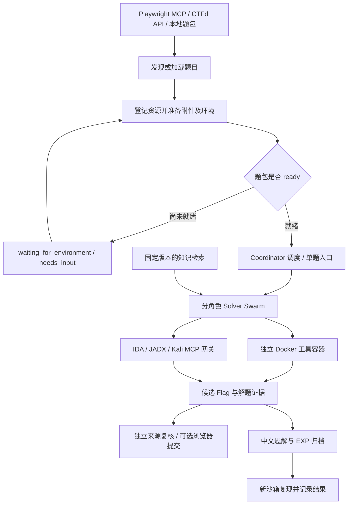

# CTF Agent All 中文使用指南

**本项目由 w1eat 参考 [verialabs/ctf-agent](https://github.com/verialabs/ctf-agent) 项目开发。** 项目沿用多模型协调解题的设计思路，并围绕平台接入、资源准备、独立验证、MCP 分析工具、知识检索和中文题解管理进行了扩展。本文的安装步骤、参数和功能说明对应本仓库的当前实现。

CTF Agent All 将一次解题组织为“题目发现 → 资源准备 → 多模型分析 → 候选验证 → 题解与 EXP 归档”的流程。适用于 CTF 比赛、已有题包的离线研究，以及带有授权远程环境的题目。

## 目录

- [本项目的创新与工程扩展](#本项目的创新与工程扩展)
- [整体架构](#整体架构)
- [环境要求与安装](#环境要求与安装)
- [模型与认证配置](#模型与认证配置)
- [浏览器平台模式](#浏览器平台模式)
- [CTFd API 模式](#ctfd-api-模式)
- [本地题目模式](#本地题目模式)
- [题型偏好与多模型协作](#题型偏好与多模型协作)
- [候选验证与平台提交](#候选验证与平台提交)
- [Solver MCP 分析工具](#solver-mcp-分析工具)
- [知识库与方法沉淀](#知识库与方法沉淀)
- [中文题解与 EXP](#中文题解与-exp)
- [并发预算与常用参数](#并发预算与常用参数)
- [运行目录与日志](#运行目录与日志)
- [常见问题](#常见问题)
- [开发检查与相关文档](#开发检查与相关文档)
- [项目来源与许可](#项目来源与许可)

## 本项目的创新与工程扩展

以下按已实现的功能说明本项目的设计重点、作用和代码入口。

| 设计重点 | 实现与作用 | 主要代码 |
| --- | --- | --- |
| 浏览器平台适配 | 通过真实页面完成平台登录、题目登记、附件下载、环境操作及 Flag 提交；用浏览器 recipe 保存可复用操作步骤。 | [`backend/platforms/`](backend/platforms/)、[`submission_setup.py`](backend/submission_setup.py) |
| 资源准备与解题分离 | 后台队列处理已登记未解题的附件准备；独立配置准备并发与解题并发，校验资源后再派发 Solver。 | [`preparation.py`](backend/preparation.py)、[`coordinator_core.py`](backend/agents/coordinator_core.py) |
| 持久化题包状态 | SQLite 保存题目、资源与运行状态；区分资源就绪、等待环境及需要人工操作，支持恢复已有运行。 | [`backend/platforms/`](backend/platforms/)、[`cli.py`](backend/cli.py) |
| 分角色协作与候选复核 | 为 Solver 分配不同分析角色，累计独立验证来源；需要时创建新的验证会话和沙箱，减少重复推理与候选误判。 | [`swarm.py`](backend/agents/swarm.py)、[`candidate_registry.py`](backend/candidate_registry.py) |
| 统一专业分析工具网关 | Claude、Codex 和 API Solver 共用 IDA、JADX、Kali 工具，以本题文件 ID 绑定分析会话，管理工具并发与生命周期。 | [`solver_mcp.py`](backend/solver_mcp.py)、[`tools/analysis.py`](backend/tools/analysis.py) |
| 知识版本与审核流程 | 联合检索历史解题记忆、本地方法卡和外部资料；运行固定知识快照，方法草稿经人工审核进入正式语料。 | [`knowledge_service.py`](backend/knowledge_service.py)、[`local_knowledge.py`](backend/local_knowledge.py) |
| 题解、EXP 与复现证据 | 候选出现后安排中文题解，保存实际脚本与产物，在新沙箱尝试复现并记录结果。 | [`writeups.py`](backend/writeups.py)、[`writeup_writer.py`](backend/writeup_writer.py) |
| 模型兼容与运行预算 | 通用 OpenAI-compatible 端点、DeepSeek 工具调用兼容、CLI/SDK Solver 后端，以及时间、工具步骤、成本和重试限制。 | [`models.py`](backend/models.py)、[`config.py`](backend/config.py)、[`backend/agents/`](backend/agents/) |
| 可追踪的运行过程 | 记录运行 ID、回合、工具调用、取消与清理过程；支持向 Coordinator 发送人工提示。 | [`tracing.py`](backend/tracing.py)、[`message_bus.py`](backend/message_bus.py) |

这些工程扩展使题目、工具、模型和解题证据能够进入同一套运行流程。知识检索的评估范围和结果见[知识检索评估](docs/knowledge-evaluation.md)；其检索命中结果需要与实际解题结果分别统计。

## 整体架构



Coordinator 管理多题发现、资源准备和任务派发；每道题由一个 Swarm 组织多个 Solver。使用 `--challenge` 时直接进入本地单题流程，使用所选 Solver，无需启动 Coordinator。

### 平台模式选择

| 模式 | 使用场景 | 主要参数 | 平台提交 |
| --- | --- | --- | --- |
| `auto` | 通过网页访问比赛平台，适合非标准 API 或复杂前端 | `--platform-url`、`--login` | 显式 `--submit` 后通过 Playwright MCP 操作 |
| `ctfd` | 标准 CTFd API，用于发现题目和下载附件 | `--ctfd-url`、`--ctfd-token` | 此模式不提交 |
| `local` | 已有题目目录、附件或远程连接信息 | `--challenge` 或 `--challenges-dir` | 此模式不提交 |

浏览器模式通过 Agent 观察具体页面，平台差异仍可能需要人工补充或调整 recipe。

## 环境要求与安装

### 依赖与运行环境

| 依赖 | 用途 |
| --- | --- |
| Git | 克隆项目、同步外部知识仓库 |
| Python 3.14+ 与 `uv` | 主程序及 Python 依赖管理 |
| Docker Desktop 或 Docker Engine | 运行 `linux/amd64` Solver 工具容器；Windows 下启用 Linux 容器 |
| 模型认证 | 为选用的 API Solver、Claude SDK 或 Codex 后端提供可用认证 |
| Node.js/npm、Chrome 或 Edge | `auto` 模式启动 Playwright MCP |
| Java、IDA/idalib、Kali 等工具环境 | 按需启用对应 Solver MCP 服务 |

项目的 Python 版本要求见 [`pyproject.toml`](pyproject.toml)。IDA 等外部工具可以使用独立的 Python 环境，其运行要求按各工具自身说明配置。

### 克隆与安装

PowerShell：

```powershell
git clone https://github.com/w1eat/ctf-agent-all.git
cd ctf-agent-all
uv sync --python 3.14
Copy-Item .env.example .env
uv run python tools/build_sandbox.py
```

Bash：

```bash
git clone https://github.com/w1eat/ctf-agent-all.git
cd ctf-agent-all
uv sync --python 3.14
cp .env.example .env
uv run python tools/build_sandbox.py
```

仓库包含 MCP 工具资源和题目文件，首次克隆体积较大。完整镜像构建会下载并安装各类 CTF 工具，默认检查 Docker 数据目录至少有 **30 GiB** 可用空间。构建与离线验收报告保存为 `logs/sandbox-build-report.json`。

已有 `ctf-sandbox` 镜像时，可只运行构建脚本的验收阶段：

```powershell
uv run python tools/build_sandbox.py --skip-build
```

确认命令入口可用：

```powershell
uv run ctf-solve --help
uv run ctf-knowledge --help
uv run ctf-writeup --help
```

### Docker 工具能力

| 类别 | 镜像中的主要工具 |
| --- | --- |
| Web / OSINT | SQLMap、ffuf、DNS/WHOIS、Playwright、Chromium |
| PWN / 逆向 | GDB、多架构运行库、QEMU user mode、radare2、Ghidra、PyGhidra |
| 密码学 | SageMath、fpylll、RsaCtfTool、CADO-NFS、flatter、PyTorch |
| 取证 / 隐写 / Misc | tshark、Scapy、Volatility 3、zsteg、stegseek、7z、John、Hashcat、OCR 和文档解析 |
| 移动端 | JADX CLI、Apktool、Androguard、ADB、Frida 客户端 |
| 区块链 | forge、cast、anvil、solc-select、Slither、Web3.py |

工具是否实际可用由 [`sandbox/tool-manifest.json`](sandbox/tool-manifest.json) 和构建验收确定，也可以直接检查镜像：

```powershell
docker run --rm ctf-sandbox ctf-tools-check --json
```

容器内的 `/tools.txt` 由同一清单生成。Android 动态分析需要外部设备或模拟器，跨架构二进制还可能需要对应运行库；题目提供的 Compose 环境由宿主环境管理器启动。

## 模型与认证配置

先编辑 `.env`，仅填写实际使用的配置。模板见 [`.env.example`](.env.example)。

### Coordinator 与 Solver

多题运行需要一个 Coordinator，可选择 `--coordinator claude` 或 `--coordinator codex`。Claude 后端需要可用的 Claude Code/SDK 认证环境，Codex 后端需要已安装、在 PATH 中可用并完成认证的 Codex CLI。比赛平台登录通过 `--login` 单独完成。

单题 `--challenge` 模式直接启动 Solver，因此可以仅配置一个 API 模型来运行本地题目。

### DeepSeek 示例

```env
DEEPSEEK_API_KEY=your_deepseek_key
DEEPSEEK_BASE_URL=https://api.deepseek.com
```

启动时显式选择 `--models deepseek/deepseek-flash`。代码对 DeepSeek 的推理字段、自动工具选择和结构化结果做了适配。

### 通用 OpenAI-compatible 接口

```env
MODEL_NAME=your_provider_model
API_KEY=your_provider_key
BASE_URL=https://your-provider.example/v1
```

将三项替换为供应商实际模型 ID、密钥和接口根地址。设置 `MODEL_NAME` 后，未传 `--models` 时自动选用该 API 模型；也可显式指定 `--models openai/your_provider_model`。供应商模型 ID 内的 `/` 会保留。

模型选择顺序为：显式 `--models` → `.env` 中的 `MODEL_NAME` → [`backend/models.py`](backend/models.py) 中的默认模型组合。初次运行建议显式选一个模型，方便检查认证、资源占用和预算。

### 模型规格写法

| 规格示例 | 后端与配置 |
| --- | --- |
| `claude-sdk/claude-opus-4-6/medium` | Claude SDK，可在模型名后指定推理等级 |
| `codex/gpt-5.4` | Codex 后端，使用 CLI 的认证环境 |
| `deepseek/deepseek-flash` | DeepSeek，使用专用变量或配置好的通用端点 |
| `google/gemini-3-flash-preview` | Google，配置 `GEMINI_API_KEY` |
| `openai/your_provider_model` | 通用兼容接口，配置 `API_KEY` 与 `BASE_URL` |

以上展示本仓库的规格格式；实际模型权限及可用型号由所用账号和供应商决定。

## 浏览器平台模式

首次运行示例，以下多行命令使用 PowerShell 的反引号续行：

```powershell
uv run ctf-solve `
  --platform auto `
  --platform-url https://platform.example.com `
  --login `
  --coordinator claude `
  --models deepseek/deepseek-flash `
  --challenges-dir challenges `
  --max-challenges 1 `
  --max-preparations 2 `
  --no-submit `
  -v
```

将示例地址替换为比赛平台地址。浏览器打开后手动完成登录，回到终端按 Enter，程序继续发现题目。`--login` 登录的是比赛平台，Claude/Codex 的认证需要在运行前准备。

浏览器 profile 默认保存在 `.runtime/playwright-profile/`，后续运行可复用登录状态。同一 profile 同时只能由一个运行使用；并行运行时用 `--browser-profile` 指定不同目录。

### 题包准备与状态

程序把已登记的未解题放入后台准备队列，优先通过页面下载按钮取得附件；需要时，在已登录浏览器上下文内执行同源下载。平台 Cookie 留在浏览器上下文中。原始附件保存在题目目录的 `distfiles/`，记录并校验文件大小及 SHA-256。

| 状态 | 含义与处理 |
| --- | --- |
| `ready` | 附件和所需环境已准备，可以启动 Solver |
| `waiting_for_environment` | 远程环境尚未启动，或连接地址尚未登记 |
| `needs_input` | 附件缺失、下载失败、需要人工操作或补充信息 |

混合题需要同时准备附件和远程环境。`--max-preparations` 控制资源准备并发，`--max-challenges` 控制活跃解题 Swarm 数量。

### 恢复运行

终端会输出 `Run ID`，状态存入 `.runtime/challenge_state.sqlite3`。使用同一题目目录、平台地址和浏览器 profile 恢复：

```powershell
uv run ctf-solve `
  --platform auto `
  --platform-url https://platform.example.com `
  --resume-run YOUR_RUN_ID `
  --models deepseek/deepseek-flash `
  --max-challenges 1 `
  --no-submit
```

恢复的是持久化题包和运行关联状态。浏览器登录过期时仍需重新登录；进程内尚未确认的提交状态需要重新建立。

## CTFd API 模式

标准 CTFd API 用于题目发现和附件下载：

```powershell
uv run ctf-solve `
  --platform ctfd `
  --ctfd-url https://ctfd.example.com `
  --ctfd-token ctfd_your_token `
  --coordinator claude `
  --models deepseek/deepseek-flash `
  --max-challenges 1 `
  --no-submit
```

`--ctfd-url` 应填写 CTFd 根地址；`/explorer` 等前端页面路由不能作为 API 根地址。复杂前端或非标准平台使用 `--platform auto --platform-url`。

CTFd API 模式不执行 Flag 提交。需要提交时，使用浏览器平台模式并显式启用 `--submit`。

## 本地题目模式

本地单题最小目录：

```text
challenges/my-challenge/
  metadata.yml
  distfiles/
    challenge.bin
```

附件题的 `metadata.yml`：

```yaml
platform: local
native_id: my-challenge
name: My Challenge
category: pwn
value: 0
description: 分析提供的二进制附件并找到 Flag。
tags: [pwn]
challenge_mode: attachment
connection_info: ""
environment: {}
```

将真实题目附件放入 `distfiles/` 后运行：

```powershell
uv run ctf-solve `
  --platform local `
  --challenge challenges/my-challenge `
  --models deepseek/deepseek-flash `
  --max-challenges 1 `
  --no-submit `
  -v
```

### 远程题与混合题

远程题在 metadata 中提供实际连接信息，例如：

```yaml
platform: local
native_id: remote-demo
name: Remote Demo
category: pwn
description: 连接题目服务并分析交互协议。
challenge_mode: remote
connection_info: "nc challenge.example.com 31337"
```

有附件且需要远程服务时，将 `challenge_mode` 设为 `hybrid`，同时提供 `distfiles/` 和 `connection_info`。远程 Web 题可以填写 URL。字段结构见 [`ChallengeMeta`](backend/prompts.py)，运行前需确认连接可从 Solver 容器访问。

原始附件按下载内容保存，Solver 在沙箱中解压和分析。模型读取附件的路径为 `/challenge/distfiles/`，生成脚本及工作文件的路径为 `/challenge/workspace/`。

## 题型偏好与多模型协作

`--challenge-type` 将目标题型作为 Coordinator 的分类偏好。Coordinator 结合分类、名称、描述、标签、附件和连接信息判断派发范围。

```powershell
uv run ctf-solve --platform auto `
  --platform-url https://platform.example.com `
  --challenge-type pwn,reverse `
  --models deepseek/deepseek-flash `
  --max-challenges 1 --no-submit
```

常见类型包括 `pwn`、`web`、`crypto`、`reverse`、`forensics`、`stego`、`misc`、`mobile`、`osint`、`blockchain`。大小写会归一化，支持 `rev`、`reversing`、`web3` 等别名；`binary exploitation` 对应 `pwn`，通用的 `binary` 或 `exploit` 标签仍需结合题目内容判断。

每个模型通过重复的 `--models` 参数传入：

```powershell
uv run ctf-solve --platform local `
  --challenge challenges/my-challenge `
  --models deepseek/deepseek-flash `
  --models claude-sdk/claude-opus-4-6/medium `
  --max-challenges 1 --no-submit
```

模型可承担 `recon`、`static_analysis`、`dynamic_exploit`、`alternative_path` 或 `verifier` 角色。角色、进度和发现会通过状态与消息通道供 Coordinator 跟踪；多个模型也会增加对应的认证和容器资源需求。

### 运行中发送人工提示

启动 `ctf-solve` 时添加 `--msg-port 9400`，然后在另一个终端运行：

```powershell
uv run ctf-msg --port 9400 "优先分析附件的输入校验，并检查现有候选的复现证据。"
```

提示由运行中的 Coordinator 接收。未固定端口时，使用启动日志显示的实际消息端口。

## 候选验证与平台提交

Flag 默认不提交，`--no-submit` 会显式选择仅解题与验证流程。模型输出先登记为候选，再累计独立来源的验证结果；默认要求两个独立来源。需要时，程序启动新的验证会话和沙箱，单模型配置也可以进行复核。

题解记录会区分候选、独立验证和平台确认。独立来源一致与平台实际接受各有对应证据；查看结果时同时关注验证状态和复现结果。

### 启用浏览器提交

```powershell
uv run ctf-solve `
  --platform auto `
  --platform-url https://platform.example.com `
  --models deepseek/deepseek-flash `
  --max-challenges 1 `
  --submit
```

提交模式在 Solver 启动前检查提交 recipe：复用有效步骤，或由 Coordinator 观察已登录页面并保存表单操作。recipe 就绪后才允许解题派发。提交后根据当前页面证据确认结果，关联正在等待确认的 Flag。

`--submit` 仅用于 `auto` 平台的 Coordinator 流程。`ctfd`、`local` 及 `--challenge` 单题模式不执行平台提交；不要同时传入 `--submit` 和 `--challenge`。

## Solver MCP 分析工具

MCP 是按需配置的扩展。普通 Docker 解题流程可以先运行；提供 `--solver-mcp-config` 后，Claude、Codex 和 API Solver 可以共用专业分析工具。

### 启用步骤

1. 按各工具自己的运行要求准备 IDA/idalib、Java/JADX、Kali 服务和所需 Python 环境。
2. 复制 [`solver-mcp.example.json`](solver-mcp.example.json) 为 `solver-mcp.local.json`。
3. 将模板中的作者机器路径、Java 路径、服务地址替换为本机实际值。仓库公开的 `solver-mcp.local.json` 也只是路径样例。
4. 验证对应工具或服务能够启动，再添加 `--solver-mcp-config`。

仓库内可使用的工具资源位置：

| 工具 | 配置重点 |
| --- | --- |
| IDA | `MCP/IDA Professional 9.3/` 为工具目录；配置 `IDADIR` 及可用的 `idalib-mcp` 命令，并准备有效授权和 idalib 运行环境。服务安装细节见 [ida-pro-mcp](https://github.com/mrexodia/ida-pro-mcp)。 |
| JADX | GUI JAR 位于 `MCP/jadx/jadx-gui-1.5.5-win/lib/`，插件 JAR 位于 `MCP/jadx/`，MCP 服务在 `MCP/jadx/jadx-mcp-server/`；需要 Java、插件和一致的端口配置。 |
| Kali | 服务端与客户端源码位于 `MCP/MCP-Kali-Server/`；Kali 中需要已安装所调用的安全工具。 |

JADX 的 `jadx_gui.command` 指向 Java，参数中的 JAR 路径指向 GUI，保留 `{file}` 占位符以加载本题 APK。MCP 服务可以按模板通过 `uv --directory ... run jadx_mcp_server.py --jadx-port 8650` 启动；该脚本包含依赖声明。确认 JADX 已加载提供的 AI MCP 插件，插件端口与 `--jadx-port` 一致。

### Kali 连接示例

在 Kali 的服务目录安装依赖并启动本机监听：

```bash
cd /path/to/ctf-agent-all/MCP/MCP-Kali-Server
python3 -m venv .venv
source .venv/bin/activate
python -m pip install -r requirements.txt
python server.py --ip 127.0.0.1 --port 5000
```

主程序和 Kali 在不同机器时，可在主机另开终端建立 SSH 转发：

```powershell
ssh -N -L 5000:127.0.0.1:5000 user@kali-host
```

将 Kali 客户端的 `--server` 设置为 `http://127.0.0.1:5000`，并确保启动客户端的 Python 已安装 `MCP/MCP-Kali-Server/requirements.txt` 中的依赖。服务具有命令执行能力，连接应限定在受控环境中。

### 运行与工具状态

```powershell
uv run ctf-solve --platform local `
  --challenge challenges/my-challenge `
  --models deepseek/deepseek-flash `
  --solver-mcp-config solver-mcp.local.json `
  --max-challenges 1 --no-submit
```

网关在 `.runtime/solver-mcp/` 为分析准备附件，识别 APK 和常见本机二进制格式。归档展开默认限制为 2 层、2 GiB 和 10,000 个条目；IDA 默认并发 4 个会话，参数可在 JSON 中调整。

Solver 通过 `list_analysis_tools` 查看可用工具，通过 `call_analysis_tool` 调用，通过 `analysis_status` 查看状态。IDA/JADX 调用使用返回的 `file_id`，绑定本题对应文件和会话。JADX GUI 按题目串行使用，并在 Manifest 匹配 APK 后开放工具；Kali 连接失败时，其工具会显示不可用，现有 Docker 工具仍可使用。

## 知识库与方法沉淀

知识检索结合三类来源：

| 来源 | 保存位置 | 使用方式 |
| --- | --- | --- |
| 历史解题记忆 | `.runtime/knowledge.sqlite3` | 提炼方法与推理；自动上下文只选取 `accepted` 记录，未验证候选保留对应状态 |
| 本地审核方法卡 | `knowledge/local/` | Markdown 正式语料，离线建立全文索引 |
| 外部 CTF 文档 | `.runtime/knowledge/` | 手动同步上游快照，索引原文与可选脚本 |

历史记忆中的 `accepted` 对应平台确认或独立验证通过的结果。知识沉淀会移除 Flag、凭据和原始工具输出，以保存可复用方法；显式检索也可以查看未验证记忆的 `outcome`。

### 同步与检索外部资料

外部来源为 [Des-CTF-Knowledge](https://github.com/Dest1ny-Sec/Des-CTF-Knowledge)。在需要联网同步时手动运行：

```powershell
uv run ctf-knowledge sync
uv run ctf-knowledge status
uv run ctf-knowledge search "PHP反序列化 wakeup" --limit 5
uv run ctf-knowledge read DOCUMENT_ID --start-line 1 --line-count 120
```

将 `DOCUMENT_ID` 替换为检索结果 ID。可以用 `sync --ref` 固定分支、标签或完整 commit。每个新运行固定知识快照，恢复运行沿用关联版本；同步失败保留旧快照，没有快照时仍可使用本地方法卡和历史记忆。

### 本地审核流程

```powershell
uv run ctf-knowledge index-local
uv run ctf-knowledge approve knowledge/inbox/reviewed-method.md
```

确认的方法可先进入 `knowledge/inbox/`。人工审核草稿后，`approve` 将其移入正式语料并重建索引。首次使用本地方法卡可运行 `index-local`；`status`、`search` 和 `read` 同时覆盖本地与外部来源。

Solver 可调用 `search_knowledge`、`read_knowledge` 和 `stage_knowledge_script`。导入工具将明确选中的外部脚本及显式依赖复制到 Docker 工作区，不自动安装依赖或执行脚本。

知识配置的默认值：

```env
KNOWLEDGE_ENABLED=true
KNOWLEDGE_DB_PATH=.runtime/knowledge.sqlite3
EXTERNAL_KNOWLEDGE_ENABLED=true
EXTERNAL_KNOWLEDGE_DIR=.runtime/knowledge
EXTERNAL_KNOWLEDGE_CONTEXT_ITEMS=4
EXTERNAL_KNOWLEDGE_CONTEXT_CHARS=4000
```

这是检索增强和方法复用，模型权重保持原有状态。文档和脚本仍需结合当前题目检查适用性；第三方文章的作者与许可信息保留在文档记录中。

## 中文题解与 EXP

候选 Flag 出现后即安排生成中文题解。后续获得平台确认或独立复核证据时，可以升级同一候选的确认状态。生成目录如下：

```text
challenges/<题目目录>/writeup.md
challenges/<题目目录>/exp/
challenges/<题目目录>/solution/manifest.json
```

题解记录解题过程、证据和结果状态。Solver 应把实际使用的 EXP 写入 `/challenge/workspace/` 并在结果中登记路径，程序在停止沙箱前保存文件，然后在新的沙箱中尝试复现。复现失败会记录待检查状态，需要人工环境的步骤会明确标注。

默认由发现候选的 Solver 模型生成题解，可以用 `--writeup-model provider/model` 或 `WRITEUP_MODEL_SPEC` 指定其他模型。生成失败可重试，已完成题解默认保留。

补写已有运行中的题解：

```powershell
uv run ctf-writeup backfill --run-id YOUR_RUN_ID
```

也可添加 `--model provider/model` 覆盖写作模型。`--force` 会重新生成已有题解，包括人工修改，应在确实需要覆盖时使用。缺少明确 Flag 或解题材料的历史题目会跳过。

## 并发预算与常用参数

### 默认预算

| 配置 | 默认值 | 作用 |
| --- | --- | --- |
| `SOLVER_ATTEMPT_TIMEOUT_SECONDS` | `1800` | 单轮 Solver 时间上限，秒 |
| `SOLVER_MAX_TOOL_STEPS_PER_ATTEMPT` | `160` | 单轮工具步骤上限 |
| `SOLVER_MAX_COST_USD` | `15` | Solver 成本预算，美元 |
| `MAX_ATTEMPTS_PER_CHALLENGE` | `5` | 每模型最多尝试轮次 |
| `FLAG_VERIFICATION_QUORUM` | `2` | 候选确认所需独立来源数 |
| `COORDINATOR_DECISION_TIMEOUT_SECONDS` | `180` | Coordinator 回合超时，设为 `0` 可关闭 |
| `PREPARATION_CONCURRENCY` | `4` | 未通过 CLI 覆盖时的资源准备并发 |
| `CONTAINER_MEMORY_LIMIT` | `16g` | 每个 Solver 容器的内存限制 |

多模型会产生额外容器、模型请求和验证会话。`--max-challenges` 默认是 10，初次运行建议显式使用 1；先确认单题流程，再按机器资源和模型预算增加并发。成本统计依赖后端返回或估算的用量，应同时关注供应商的实际计费。

### 常用 CLI 参数

| 参数 | 用途 |
| --- | --- |
| `--platform` | 选择 `auto`、`ctfd` 或 `local` |
| `--platform-url` | 浏览器平台地址 |
| `--login` | 打开浏览器并等待一次人工平台登录 |
| `--browser-profile` | 指定持久化浏览器 profile |
| `--ctfd-url` / `--ctfd-token` | 标准 CTFd API 地址与凭据 |
| `--challenge` | 直接运行一个本地题目目录 |
| `--challenges-dir` | 多题发现与产物保存的根目录 |
| `--coordinator` / `--coordinator-model` | 选择协调后端和对应模型 |
| `--models` | 选择 Solver，可重复传入 |
| `--challenge-type` | Coordinator 题型偏好，可重复或逗号分隔 |
| `--max-challenges` / `--max-preparations` | 分别控制解题与准备并发 |
| `--no-submit` / `--submit` | 仅验证或启用浏览器提交 |
| `--resume-run` | 使用已有运行 ID 恢复 |
| `--solver-mcp-config` | 指定分析工具网关 JSON |
| `--writeup-model` | 覆盖题解模型 |
| `--image` | 选择 Solver Docker 镜像，默认 `ctf-sandbox` |
| `--msg-port` | 固定人工提示通道端口，默认自动分配 |
| `-v` | 输出详细日志 |

### Coordinator 全权限模式

默认使用受限工具集。显式添加 `--coordinator-full-access` 后，Claude/Codex Coordinator 可使用原生 Agent 工具、宿主 Shell、文件和网络能力。例如在已有启动命令中添加：

```text
--coordinator codex --coordinator-full-access
```

该模式扩大宿主访问范围，Codex 配置为 `danger-full-access` 并关闭命令审批，适合在专用研究环境中使用。可用 `--no-coordinator-full-access` 显式关闭。

## 运行目录与日志

```text
backend/                 主程序、Agent、平台、工具、知识库和题解逻辑
sandbox/                 工具镜像、清单、依赖与离线验收
MCP/                     工具资源和 MCP 服务源码
knowledge/local/         正式本地方法卡
knowledge/inbox/         待审核方法草稿
challenges/              题目 metadata、附件、题解和 EXP
docs/                    专项文档与评估记录
tests/                   功能与编排测试
tools/                   构建、检索评估和题包辅助脚本
.runtime/                状态库、知识索引、浏览器会话和 MCP 临时文件
logs/                    结构化诊断、终端日志、构建报告
```

Coordinator 的结构化日志为 `logs/coordinator-<run_id>-<timestamp>.jsonl`，终端日志为 `logs/run-<run_id>-<timestamp>.log`。日志记录原始工具输入输出，可能包含平台数据、凭据和 Flag。运行结束时保留最新运行，其他日志按 7 天或总计 1 GiB 的限制轮转。

当前 [`.gitignore`](.gitignore) 排除 `.env`、`.runtime/`、`logs/`、虚拟环境、缓存和 `.hexlic` 软件许可证。**`challenges/` 当前已纳入版本控制**，生成的题解与 EXP 会出现在工作区；发布前需检查实际待提交文件及其中的题目结果。

## 常见问题

### 只填写 API Key，为什么 Coordinator 仍不能启动？

API Key 用于所选 API Solver。多题运行还需要配置 `--coordinator claude` 或 `--coordinator codex` 对应的 SDK/CLI 认证环境。可以先用 `--platform local --challenge` 验证单个 API Solver。

### Docker 构建失败或空间不足

确认 Docker 引擎已启动，并使用 Linux 容器。构建脚本默认要求 Docker 数据目录有 30 GiB 可用空间；磁盘位置以构建输出中的 Docker data root 为准。查看 `logs/sandbox-build-report.json` 和构建终端输出定位缺失工具或离线验收失败。

### 浏览器启动失败或 profile 被占用

确认 Node.js/npm 与 Chrome/Edge 可用，必要时在 `.env` 指定：

```env
PLAYWRIGHT_EXECUTABLE_PATH=C:\Program Files\Google\Chrome\Application\chrome.exe
```

项目默认启动固定版本 `@playwright/mcp@0.0.82`。可以检查该版本的命令入口：

```powershell
npx -y @playwright/mcp@0.0.82 --help
```

profile 被占用时先停止占用它的运行，或通过 `--browser-profile` 换用独立目录。登录过期则重新添加 `--login`。

### 题目已发现，但 Solver 没有启动

查看题包状态、附件下载结果及连接信息。`waiting_for_environment` 需要启动或登记环境，`needs_input` 需要处理缺失附件或人工步骤；混合题必须同时满足两类资源。日志会显示准备失败原因。

### CTFd 返回 HTML 或 JSON 解析失败

检查 `--ctfd-url` 是否指向标准 CTFd 根地址。前端页面或非标准平台使用 `--platform auto --platform-url`。

### IDA / JADX / Kali 工具不可用

检查 JSON 中的实际路径、独立工具环境和启动命令。IDA 需要有效授权与可用 idalib；JADX 需要已加载插件、匹配端口和正确 APK；Kali 需要服务可达及对应命令已安装。Solver 的 `analysis_status` 可查看工具状态。

### DeepSeek 报工具选择错误

确认正在使用本仓库的模型适配代码及正确的 `deepseek/` 规格。该适配使用自动工具选择并处理推理字段；自定义兼容网关还需要支持对应请求格式。

### 如何停止和恢复？

在运行终端按 `Ctrl+C`，程序会取消任务并清理项目创建的相关资源。需要继续时，用启动日志中的 Run ID 配合 `--resume-run`，并保持题目目录和平台配置一致。

## 开发检查与相关文档

查看命令参数：

```powershell
uv run ctf-solve --help
uv run ctf-knowledge --help
uv run ctf-writeup backfill --help
uv run ctf-msg --help
```

修改程序后可运行现有测试与静态检查：

```powershell
uv run pytest -q
uv run ruff check backend tests
uv run ty check backend
uv run python -m compileall -q backend tests
```

专项检索评估：

```powershell
uv run ctf-knowledge index-local
uv run python -m tools.evaluate_knowledge
```

相关入口：

- [项目首页](README.md)
- [环境变量模板](.env.example)
- [Solver MCP 配置模板](solver-mcp.example.json)
- [Docker 构建文件](sandbox/Dockerfile.sandbox)
- [沙箱工具清单](sandbox/tool-manifest.json)
- [知识检索评估及其范围](docs/knowledge-evaluation.md)
- [Kali MCP 服务说明](MCP/MCP-Kali-Server/README.md)
- [JADX MCP 服务说明](MCP/jadx/jadx-mcp-server/README.md)

## 项目来源与许可

项目开发来源和参考关系已在本文开头说明。项目许可证见 [LICENSE](LICENSE)，其中保留所参考代码的版权及许可信息。MCP 目录中的第三方程序、插件和外部知识资料按各自许可使用；软件许可证和个人认证信息需要在本机准备。

本项目面向 CTF 与获得授权的题目环境。Solver 容器具有系统管理、调试及设备访问能力，宿主 MCP 和全权限 Coordinator 还会访问容器之外的工具环境，部署时按实际能力配置隔离与资源限制。
